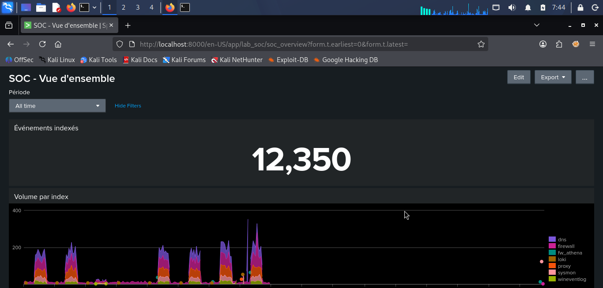
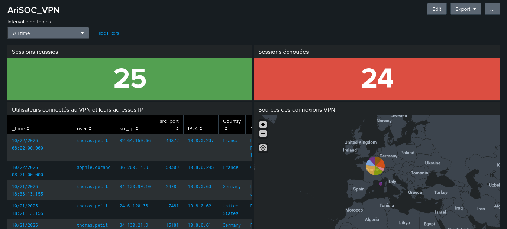
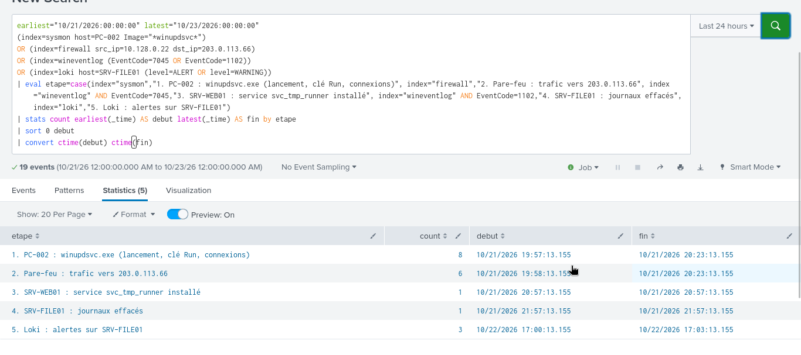
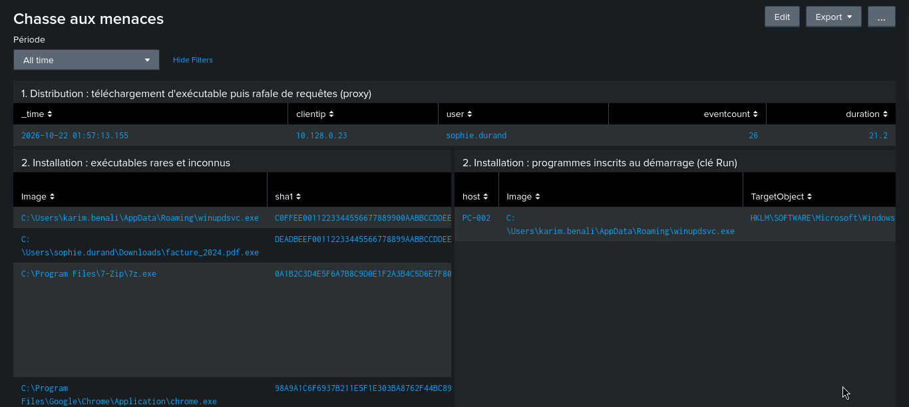

# Lab SOC avec Splunk

Un mini-SOC construit à la main avec Splunk Enterprise (Docker), inspiré d'un rapport de stage sur les solutions SOC/SIEM NextGen (Arismore, 2017). Toutes les données sont synthétiques.

## Aperçu









## Ce que contient le lab

| Domaine | Détail |
|---|---|
| Plateforme | Splunk Enterprise 9.4.15 dans Docker |
| Sources | 7 sources : VPN, pare-feu, journaux Windows, Sysmon, DNS, proxy, scanner Loki (plus la réception syslog UDP) |
| Enrichissement | 5 tables : liste blanche SHA1, IP malveillantes, domaines IOC, pays VPN autorisés, identités |
| Alertes | 12 alertes planifiées, toutes les 5 minutes |
| Tableaux de bord | 5 : vue d'ensemble, VPN, pare-feu, utilisateur, chasse aux menaces |
| Incidents | 2 scénarios d'attaque à reconstituer |

## Démarrage

```
git clone https://github.com/dynamx0/splunk-soc-lab.git
cd splunk-soc-lab
cp .env.example .env
python3 generator/soc_lab_gen.py history --days 7 --out data
docker compose up -d
sudo chmod -R a+rwX app data generator
```

Avant de lancer, édite `.env` et choisis un mot de passe (8 caractères minimum). Attends environ 2 minutes, puis ouvre http://localhost:8000 (utilisateur `admin`) et l'application Lab SOC NextGen.

Les droits doivent être réappliqués (dernière commande) après chaque démarrage de Splunk.

## Détections

- **VPN** : déplacement impossible, force brute, compte utilisé depuis trop d'IP, pays inhabituel
- **Windows** : force brute Active Directory, journaux effacés, service suspect installé
- **Sysmon** : exécutable rare et inconnu, persistance par la clé Run, ransomware (plus de 10 fichiers par minute hors liste blanche)
- **Réseau** : trafic autorisé vers une IP de la liste noire, activité DNS anormale, téléchargement d'un exécutable suivi d'une rafale de requêtes
- **Loki** : indicateurs de compromission détectés

## Tester une alerte

Les alertes ne regardent que les dernières minutes : on injecte donc une attaque datée de maintenant.

```
python3 generator/soc_lab_gen.py list
python3 generator/soc_lab_gen.py live --scenario vpn_bruteforce --out data
```

Attends le prochain passage de l'alerte (toutes les 5 minutes), puis ouvre Activity, Triggered Alerts.

## Structure du dépôt

- `app/lab_soc/default/` : configuration Splunk, alertes, tableaux de bord et menu
- `app/lab_soc/lookups/` : les tables d'enrichissement
- `generator/` : le générateur de journaux synthétiques
- `docker-compose.yml` : le déploiement

## À savoir

- L'essai Splunk dure 60 jours. Ensuite, la licence gratuite désactive les alertes planifiées.
- Les journaux sont fictifs. Le serveur C&C et les domaines utilisent des plages réservées à la documentation (203.0.113.0/24, 198.51.100.0/24, `.example`). Les adresses IP sources externes sont des adresses publiques arbitraires, choisies pour illustrer la géolocalisation : elles n'ont aucun lien avec de vrais incidents.
